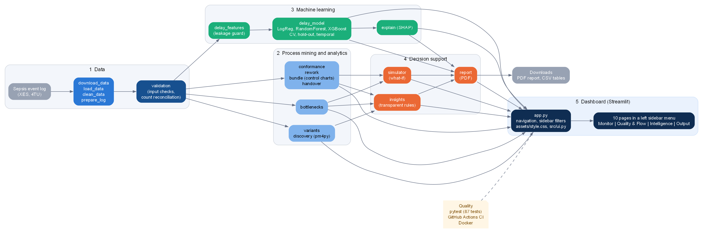

# CareFlow 2.0: Clinical Pathway Monitoring, Predictive Analytics and Explainable Decision Support

Process mining, machine learning and decision support for real sepsis emergency-room data.
Data Analytics internship project at Infotact Solutions (Ref. ITS/DA/1370).



## What it does
Hospitals record every step of a patient's journey but rarely study how patients really move through care. CareFlow turns a public hospital event log into an interactive decision-support dashboard that answers:

1. **Which pathways do patients really follow?** (process discovery, variants, patient journeys)
2. **Where do they wait?** (bottleneck analysis, monthly delay trends)
3. **Do they follow the expected pathway, and is care improving?** (conformance checking, care-bundle scorecard with control charts)
4. **How do departments hand patients over?** (rework, returns, handover network)
5. **Can delay be predicted, and why?** (validated models with SHAP explanations)
6. **What if the waits were shorter?** (transparent what-if simulator)
7. **What deserves attention first?** (rule-based insights, downloadable PDF reports)

## Dashboard
```bash
streamlit run app.py
```
A permanent **left sidebar menu** with four groups and ten pages. The CareFlow logo sits at the top, the active page is highlighted, and the patient filters (registration dates, how the case ended, age group, returned to the ER) are in a collapsible **Patient filters** section below the menu, under a live "Patients selected" counter. Every page responds to the same filters. KPI and insight cards use a responsive grid: four columns on desktop, two on tablets, one on phones.

| Group | Page | Contents |
|---|---|---|
| **MONITOR** | **Overview** | Key figures, insight cards, patients per month, how cases end, case duration, top operational bottlenecks |
| | **Patient Pathways** | Sub-tabs: common pathways, interactive process map, single-patient journey |
| | **Bottleneck Analysis** | Waits between steps, time to antibiotics, registration-to-triage waits, monthly delay trends, delay by arrival time |
| **QUALITY & FLOW** | **Quality & Conformance** | Sub-tabs: expected versus actual pathway (fitness, missing and extra steps); care-bundle scorecard with monthly control charts |
| | **Department Flow** | Sub-tabs: repeated steps, returns and ward stays; department handover network and ward transfers |
| **INTELLIGENCE** | **Predictive Intelligence** | Delay models (logistic regression, random forest, XGBoost), ROC/PR curves, risk groups, SHAP importance and per-patient explanations |
| | **What-if Simulator** | Hypothetical shorter waits, baseline against scenario, sensitivity curve (clearly labelled hypothetical) |
| | **Smart Insights** | Transparent rules that flag workflow issues, each with the rule, the evidence and what to review |
| **OUTPUT** | **Reports** | Downloadable PDF with key figures, findings, charts, optional model summary and what-if scenario |
| | **About** | Dataset, methodology, technologies, cleaning, limitations, references |

## Key results
Cleaned data: **995 patients, 14,214 events** (from 1,050 patients and 15,214 events in the raw log).

| Finding | Result |
|---|---|
| Typical case length | median 5.2 days; 26% finish within a day, 19% last over 30 days |
| Pathway variety | 619 exact pathways (54% of patients follow one nobody else did), only **96** once repeated lab tests are left out; the top 10 cover **73%** |
| Treatment speed | **33%** of treated patients receive antibiotics within 1 hour of registration (26% of all patients; 72% of treated patients within 3 hours) |
| Where the delay is | Among patients treated after more than 1 hour, the long wait is **after** sepsis triage (median 2.5 h), not before it (median 10 minutes) |
| Conformance | 33% follow the assumed expected pathway exactly (average fitness 0.90) |
| Care bundle | 18% meet every applicable early-care element on time; care is stable but low (one month outside control limits) |
| Rework | 30% repeat a step, almost always the ward admission record; 89% of those repeats are recorded by a different unit, so they are mostly **transfers** |
| Returns | 37.6% of discharged patients return to the ER (median 46.5 days later); 15% within 30 days |
| Missing endings | 26% of patients have no discharge event recorded |
| **Predicting delay** | **At registration: no better than chance (ROC-AUC 0.50). At sepsis triage: a weak signal (ROC-AUC 0.58).** Delays are mostly not explained by patient or arrival information |

Results show where delays happen, not why.

### Event counts: 14,214 and 14,208
Both numbers are correct; they describe two pipeline stages. The **cleaned log has 14,214 events**. `prepare_log.py` then drops activities seen in under 1% of patients, which removes only `Release E` (**6 events, 6 patients**), leaving **14,208 events** for pathway, process-map and waiting-time analysis. The patient count (995) never changes. `src/validation.py` reconciles the two stages, the dashboard labels each one, and a test checks the arithmetic.

### Percentages with different denominators
"Antibiotics within 1 hour" is **33% of treated patients** (259 of 776) in the waiting-time views, and **26% of all patients** (259 of 995) in the care bundle. Same 259 patients, different denominators, labelled on screen.

## Predictive intelligence, honestly
The model answers: *will the first antibiotics be given more than 1 hour after registration?* Rules that keep it honest:

* **Leakage control:** only information available at the chosen prediction point is used (`src/delay_features.py`); lab results, the diagnosis code, test-order flags and the infusion flag are forbidden and guarded by tests.
* **Validation:** patient-level 5-fold cross-validation, an 80/20 hold-out, a temporal split, and a do-nothing baseline; precision, recall, F1, ROC-AUC and PR-AUC; class weights for imbalance.
* **Result:** no usable signal at registration, a weak signal at sepsis triage. Full tables are in [docs/model_evaluation.md](docs/model_evaluation.md), generated from `reports/delay_model_evaluation.csv`.
* **Explanations:** SHAP shows what drives the model (at triage, waiting longer for triage predicts a longer wait for antibiotics). It explains the model, not causes.

This is a research demonstration, not a clinical tool.

## Quick start
```powershell
python -m venv .venv
.venv\Scripts\Activate.ps1            # Git Bash: source .venv/Scripts/activate
pip install -r requirements.txt
winget install Graphviz.Graphviz      # only needed to redraw the process maps

python src/download_data.py           # fetch the raw event log into data/raw/
python src/clean_data.py              # clean it
python src/prepare_log.py             # prepare it for process mining

streamlit run app.py                  # open the dashboard
```
`src/discovery.py` finds Graphviz in `C:\Program Files\Graphviz\bin` even if it is not on your PATH. The first start of the Predictive tab trains the models (about 30 seconds) and caches them in `data/processed/`.

## The pipeline
Each script writes to `data/processed/` (not committed) or `reports/`.

| # | Script | What it does | Main outputs |
|---|---|---|---|
| 1 | [src/download_data.py](src/download_data.py) | Downloads the Sepsis event log | `data/raw/sepsis.xes` |
| 2 | [src/load_data.py](src/load_data.py) | Loads the XES file into a table | (used by later steps) |
| 3 | [src/clean_data.py](src/clean_data.py) | Removes duplicates and 55 impossible cases, fills case details | `sepsis_clean.csv`, [data quality report](reports/data_quality_report.md) |
| 4 | [src/prepare_log.py](src/prepare_log.py) | Fixes tie order, filters rare activities, adds waiting-time features | `sepsis_events.csv`, `sepsis_cases.csv`, [report](reports/event_log_preparation.md) |
| 5 | [src/variants.py](src/variants.py) | Counts pathway variants at two levels of detail | [top variants](reports/top_variants.csv) |
| 6 | [src/discovery.py](src/discovery.py) | Draws process maps and scores the models | [model evaluation](reports/model_evaluation.csv), maps in `reports/figures/` |
| 7 | [src/bottlenecks.py](src/bottlenecks.py) | Measures waits between steps | [transitions table](reports/bottleneck_transitions.csv) |
| 8 | [src/conformance.py](src/conformance.py) | Checks each patient against an expected sepsis pathway | [deviation summary](reports/conformance_summary.csv) |
| 9 | [src/rework.py](src/rework.py) | Finds repeated steps, loops and return visits | [summary](reports/rework_summary.csv) |
| 10 | [src/bundle.py](src/bundle.py) | Adapted care-bundle scorecard with control charts | [scorecard](reports/bundle_scorecard.csv) |
| 11 | [src/handover.py](src/handover.py) | Department handovers and ward transfers | [handover pairs](reports/handover_pairs.csv) |
| 12 | [src/delay_model.py](src/delay_model.py) | Trains and validates the delay models | [evaluation](reports/delay_model_evaluation.csv) |

Supporting modules: [delay_features](src/delay_features.py) (features and leakage guard), [explain](src/explain.py) (SHAP), [simulator](src/simulator.py), [insights](src/insights.py), [report](src/report.py) (PDF), [validation](src/validation.py) (input checks and count reconciliation). Read processed files with `load_clean_log()`, `load_events()` and `load_cases()`; one case ID is literally `NA`, which a plain `pd.read_csv` would turn into a missing value.

### Notebooks
Outputs are saved, so they can be read without re-running: [01 load](notebooks/01_load_data.ipynb), [02 EDA](notebooks/02_eda.ipynb), [03 variants](notebooks/03_variants.ipynb), [04 process discovery](notebooks/04_process_discovery.ipynb), [05 bottlenecks](notebooks/05_bottlenecks.ipynb), [06 conformance](notebooks/06_conformance.ipynb), [07 rework](notebooks/07_rework.ipynb), [08 care bundle](notebooks/08_bundle_scorecard.ipynb), [09 departments](notebooks/09_department_handover.ipynb).

## Testing and quality
```powershell
python -m pytest -q
```
87 tests cover the leakage guard and features, model training and validation (including a planted-signal test and a pure-noise test), SHAP, the simulator (never makes waits longer, monotonic), every insight rule, PDF generation, count reconciliation, and real-data checks (995 patients, 14,214 and 14,208 events, 329 conforming patients, the denominators above) plus a render check of every dashboard page, the sidebar menu structure, and each patient filter. Tests that need the real data skip themselves when it is missing.

* **GitHub Actions** ([.github/workflows/ci.yml](.github/workflows/ci.yml)) compiles everything and runs the tests on every push; a best-effort job downloads the real dataset and runs the integration tests too.
* **Docker** ([Dockerfile](Dockerfile), [docker/entrypoint.sh](docker/entrypoint.sh)): `docker build -t careflow .` then `docker run -p 8501:8501 careflow`. The first start downloads the dataset and builds the processed data. The Docker files have been written but not built or run yet.

## Project structure
```
careflow/
├── app.py                    # page set-up and page flow
├── dashboard/                # sidebar menu (4 groups, 10 pages), filters, data context, one module per page
│   └── tabs/
├── src/                      # pipeline, analytics, ML, simulator, insights, report
├── tests/                    # pytest suite (synthetic data + real-data checks)
├── assets/style.css          # dashboard stylesheet
├── data/                     # raw and processed data (not committed)
├── docs/                     # data dictionary, model evaluation, architecture diagram
├── notebooks/                # nine analysis notebooks
├── reports/                  # quality reports, tables, figures
├── .github/workflows/ci.yml
├── Dockerfile, docker/, .dockerignore
└── requirements.txt, pytest.ini
```

## Dataset
*Sepsis Cases - Event Log* (Mannhardt, 2016, 4TU.ResearchData, DOI 10.4121/uuid:915d2bfb-7e84-49ad-a286-dc35f063a460): real, anonymised hospital data. See [docs/data_dictionary.md](docs/data_dictionary.md).

## Limitations
- A public research dataset from one hospital, not data supplied by the company; timestamps were entered retrospectively.
- 26% of patients have no discharge event, and the reason is not in the data.
- The expected pathway (conformance) and the care-bundle scorecard are adapted for this project; they are not official clinical measures. The antibiotic clock starts at ER registration because the log has no time of sepsis recognition.
- Department codes are anonymised; roles such as Laboratory or Ward are inferred from the steps each department records.
- The delay model has no skill at registration and only weak skill at triage. SHAP explains the model, not causes. The simulator is arithmetic on recorded waits, not a forecast.
- Nothing in this project is clinical advice.

## Roadmap
- [x] Cleaning, preparation, pathways, process maps, bottlenecks
- [x] Conformance, rework, care bundle with control charts, department handovers
- [x] Ten-tab dashboard with validated, consistent filters and denominators
- [x] Leakage-controlled delay prediction with SHAP, what-if simulator, rule-based insights, PDF reports
- [x] Tests, GitHub Actions, Docker configuration, architecture diagram
- [ ] Confirm the expected pathway and bundle definitions with the mentor
- [ ] Build and run the Docker image
- [ ] Final project report and presentation
